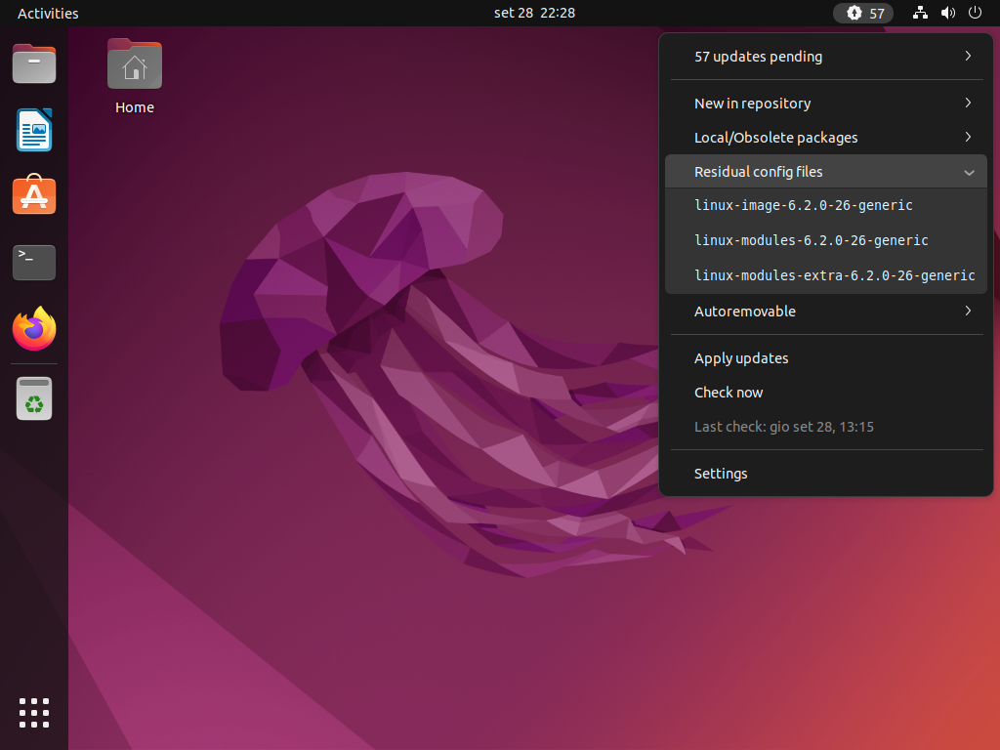
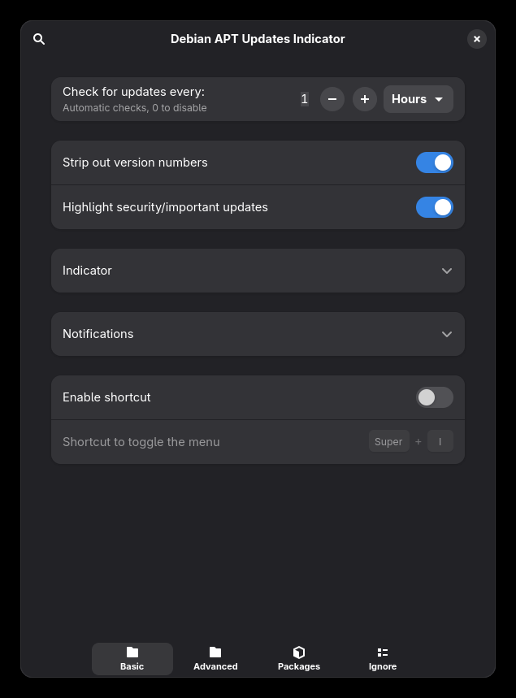
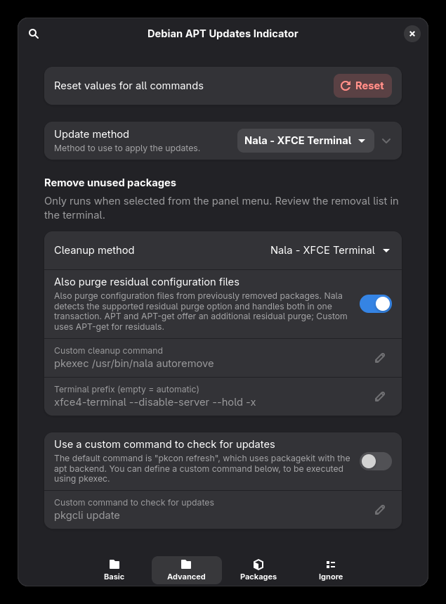
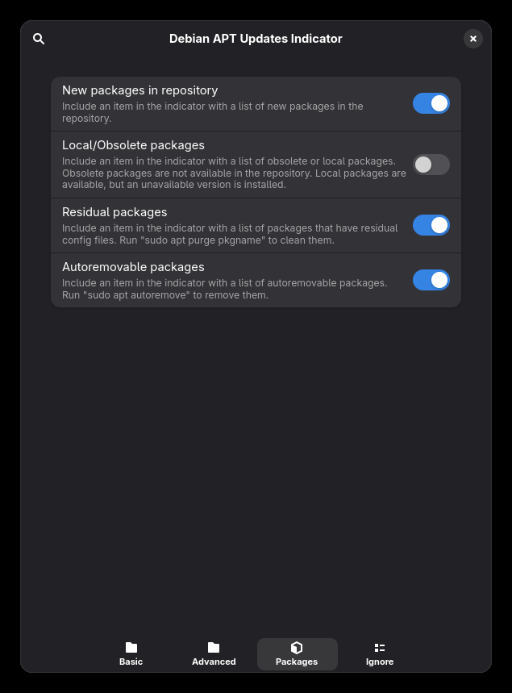
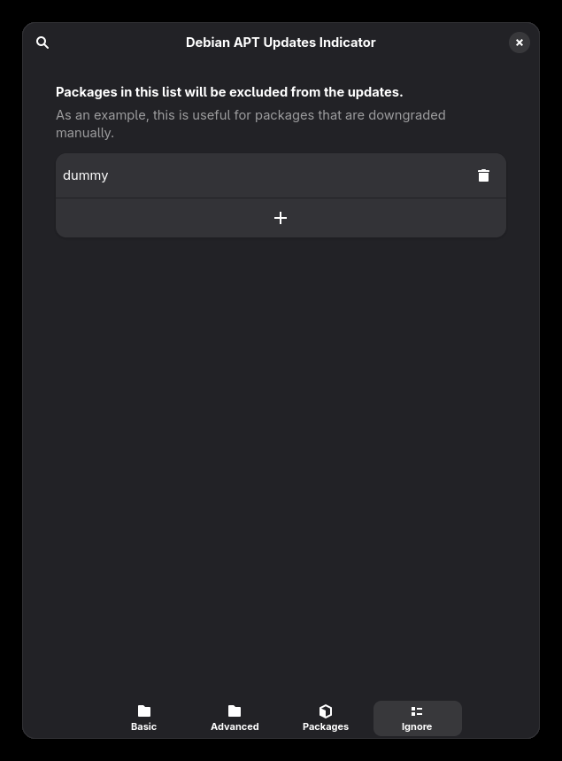

# Debian APT Updates Indicator

**Maintained by [vanastasis](https://github.com/vanastasis)**

A GNOME Shell panel extension for monitoring and managing APT package updates on Debian and Debian-based Linux distributions.

**Version:** `2.7.0.10` | **GNOME Shell:** 48–51 | **Licence:** GPL-3.0-or-later

## What's new in 2.7.0.10

- Fix stuck checking indicator when PackageKit refresh or optional security classification stalls.
- Run the actual configured refresh command for both Check now and scheduled checks; use pkcon refresh force or pkgcli refresh by default.
- Reject common install, upgrade and removal commands mistakenly configured as a refresh command.
- Bound repository refresh to five minutes and package-list queries to one minute; report failures without recording a false successful check.
- Keep refresh and primary scan locked together, redraw updates before optional urgency classification and preserve unformatted package data.
- Honour hours, days, weeks and zero (disabled); defer busy scheduled checks and retry failed scheduled checks without waiting a full interval.
- Add mocked refresh lifecycle and scheduling regression tests; retain declared GNOME Shell 48–51 compatibility.

## Features

- Available updates and optional critical-update notifications.
- New packages in repositories, local/obsolete packages, residual configuration files and autoremovable packages.
- Manual and automatic update checks with hourly, daily or weekly intervals.
- Configurable refresh commands, ignore list and last-check timestamp.
- GNOME Shell 48–51 panel-layout compatibility and corrected timer lifecycle.
- Existing settings and translations retained; new strings may appear in English until translated.

## Screenshots

### Desktop overview



The panel menu brings together the available updates, **Apply updates**, **Remove unused packages**, **Check now**, the last successful check time and access to Settings. Update and cleanup actions are separate; their availability reflects the detected package state.

### Preferences — animated preview

<p align="center">
  
</p>

### Settings windows

<table>
  <tr>
    <th width="50%">Basic</th>
    <th width="50%">Advanced</th>
  </tr>
  <tr>
    <td align="center" valign="top"><a href="assets/Screenshot_02.webp"></a></td>
    <td align="center" valign="top"><a href="assets/Screenshot_03.webp"></a></td>
  </tr>
  <tr>
    <td valign="top">Set automatic refresh intervals in hours, days or weeks (zero disables automatic checks). Configure version-number display, security highlighting, indicator visibility, notifications and keyboard shortcuts.</td>
    <td valign="top">Select independent update and cleanup methods using APT, APT-get, Nala or custom commands. Configure optional residual configuration purging, terminal settings and the repository refresh command. Reset command preferences when needed.</td>
  </tr>
  <tr>
    <th>Packages</th>
    <th>Ignore</th>
  </tr>
  <tr>
    <td align="center" valign="top"><a href="assets/Screenshot_04.webp"></a></td>
    <td align="center" valign="top"><a href="assets/Screenshot_05.webp"></a></td>
  </tr>
  <tr>
    <td valign="top">Choose which package categories appear in the panel menu: new repository packages, local or obsolete packages, residual configuration files and autoremovable packages.</td>
    <td valign="top">Manage packages excluded from the extension's displayed update list. This display filter is not an APT package hold and does not prevent a package manager from upgrading a package.</td>
  </tr>
</table>

Select an individual screenshot to view it at full size. These screenshots illustrate the interface and example settings; the exact wording may differ slightly from the latest release. Use refresh-only commands for automatic checks (for example, `pkgcli refresh`, not `pkgcli update`).

## Repository refresh

**Check now** and scheduled checks execute the same refresh command selected in Advanced settings. With custom refresh disabled, the extension uses `pkcon --plain refresh force` if available, otherwise `pkgcli refresh`. A custom refresh command is used as entered, including any explicitly configured authentication; `pkgcli update` installs updates and is not a refresh command. A successful refresh followed by a successful local APT scan records Last check; local cache changes and initial scans do not. A five-minute refresh timeout and one-minute scan timeout prevent an indefinitely checking indicator; stopping the client does not guarantee that PackageKit's backend or an arbitrary custom command has stopped. A busy scheduled check is deferred 30 seconds, and failed automatic checks retry after up to five minutes. Zero disables scheduled checks. Optional urgency classification is currently available through pkcon and does not block the normal update list.

## Advanced settings

| Method | Apply updates | Remove unused packages |
| --- | --- | --- |
| APT – Default Terminal | `apt full-upgrade -o APT::Get::AutomaticRemove=false` | `apt autoremove` |
| APT-get – Default Terminal | `apt-get dist-upgrade -o APT::Get::AutomaticRemove=false` | `apt-get autoremove` |
| Nala – XFCE Terminal | `nala full-upgrade --assume-yes` plus the detected no-autoremove option | `nala autoremove` |
| Custom | User-defined | User-defined |
| GNOME Software, Synaptic, PackageKit, Ubuntu Update Manager | GUI update methods | — |

Built-in terminal commands use `pkexec`. Install Nala and `xfce4-terminal` to use the Nala presets. Full upgrades can still remove conflicting packages to resolve dependencies; disabling autoremove is not a guarantee against all removals. Automatic checks do not automatically install upgrades or run cleanup. The Nala update preset detects `--no-autoremove` or `--no-auto-remove` from the installed command help; the residual cleanup preset detects `--config` or `--remove-config`. If detection fails, the corresponding transaction is not started.

**Optional residual purge:** enable **Also purge residual configuration files** in Advanced settings. Nala uses `nala autoremove --purge` with the detected `--config` (0.16.0) or `--remove-config` (0.18.1) option in a single interactive transaction, including when only residual configurations remain. APT and APT-get use `autoremove --purge` followed by a freshly detected list of remaining `rc` packages for explicit confirmation. Custom commands remain unchanged, with APT-get used for the extra purge. The switch is off by default; disabling it retains ordinary cleanup behaviour.

Package-list cache: `$XDG_CACHE_HOME/debian-updates-indicator@vanastasis.github.com/` (normally under `~/.cache`). The default refresh requires `pkcon` or `pkgcli`; if neither exists, install PackageKit or configure a custom refresh command. Obsolete-package detection is optional and requires `apt-show-versions`. Built-in terminal commands track completion via a private marker; arbitrary GUI/custom commands may still detach. A forcibly killed terminal can leave tracking pending until the extension is restarted; do not restart it during a package transaction.

## Compatibility

GNOME Shell 48, 49, 50 and 51 are the declared compatibility targets. GNOME Shell 51 has been exercised by the maintainer; live runtime testing of this release on GNOME Shell 48–50 is still required. Earlier versions and unreleased future versions are not declared supported. Build and schema validation do not establish live runtime compatibility for every terminal or distribution.

## Installation

Download the installable ZIP from [GitHub Releases](https://github.com/vanastasis/gnome-shell-extension-debian-updates-indicator/releases):

`debian-updates-indicator@vanastasis.github.com.shell-extension.zip`

Do not use GitHub's automatically generated source archive as an installable extension. The GitHub release asset includes compiled schemas and translations.

```bash
gnome-extensions install --force "debian-updates-indicator@vanastasis.github.com.shell-extension.zip"
```

Alternatively, manually extract the GitHub release ZIP into `~/.local/share/gnome-shell/extensions/debian-updates-indicator@vanastasis.github.com/`.

If replacing the upstream extension, disable the old UUID first; both share a GSettings schema. On Wayland, log out and back in if the old JavaScript is still cached, then enable the extension:

```bash
gnome-extensions enable debian-updates-indicator@vanastasis.github.com
gnome-extensions info debian-updates-indicator@vanastasis.github.com
```

A separate GNOME Extensions submission archive omits the compiled GSettings schema. Publication on extensions.gnome.org is subject to review; GitHub publication does not automatically update that listing.

## Build from source

```bash
sudo apt install git meson ninja-build gettext libglib2.0-bin
git clone --branch main https://github.com/vanastasis/gnome-shell-extension-debian-updates-indicator.git
cd gnome-shell-extension-debian-updates-indicator
meson setup --prefix="$HOME/.local" _build
meson compile -C _build
meson install -C _build
```

## Publish a release (maintainers)

From the repository root, run `./publish-release.sh VERSION release-notes.md` after reviewing local changes. The script stages tracked edits and builds from the staged source, installs locally, pushes to GitHub and creates a release with the GitHub ZIP and checksum. Stage any new source files explicitly first. The separate EGO ZIP is generated for manual submission.

Publishing requires Node.js, gettext, GLib schema utilities and Shexli (on PATH or in `~/.venvs/shexli`). The publisher saves validation reports under `zip-files/validation/`. New strings are included in the translation template; existing translations are preserved and untranslated strings fall back to English. It blocks on non-allowlisted Shexli errors; any other findings require explicit acknowledgment. The known `EGO-M-004` finding must be reviewed rather than automatically ignored.

### Shexli 0.2.1 and GNOME 51

The maintainer reproduced `EGO-M-004` using temporary copies of the 2.7.0.10 submission archive: GNOME 48, 49 and 50 passed individually and together; GNOME 51 alone triggered the finding. The installed Shexli 0.2.1 source confirmed that `shexli/analyzer/rules/metadata.py` contains the hardcoded condition `if major > 50:`.

A maintainer-local correction to `if major > 51:`, with the original analyzer file backed up, produced **0 findings, 0 errors and 0 warnings** on the unchanged 2.7.0.10 EGO archive. This is a local analyzer correction, not a change to the extension or a bypass of the rule. Versions above 51 and the rule's other metadata checks remain subject to validation. Prefer an upstream Shexli release that corrects the limit when available; an analyzer upgrade may replace the local patch.

The published extension ZIPs and GNOME 48–51 declarations remain unchanged. The local clean report does not establish approval by GNOME Extensions or runtime compatibility on every declared Shell version; the website's independent analyzer may still flag the older limit. Do not automatically suppress other findings.

## Changes and support

- [Changelog](CHANGELOG.md)
- [GitHub releases](https://github.com/vanastasis/gnome-shell-extension-debian-updates-indicator/releases)
- [Report an issue](https://github.com/vanastasis/gnome-shell-extension-debian-updates-indicator/issues)
- [Contribute a change](https://github.com/vanastasis/gnome-shell-extension-debian-updates-indicator/pulls)

The maintained branch is `main`. Other imported branches are historical.

## Attribution and licence

Derived from the [original Debian Linux Updates Indicator](https://gitlab.gnome.org/glerro/gnome-shell-extension-debian-updates-indicator) by Gianni Lerro, copyright 2023–2026, with contributions and original work by Fran Glais and Raphael Rochet. Original copyright, author, translation and SPDX notices remain intact.

Modifications by vanastasis, 2026-11-26.

Licensed under the GNU General Public License, version 3 or later (GPL-3.0-or-later). See [COPYING](COPYING) for full terms. Provided without warranty.
